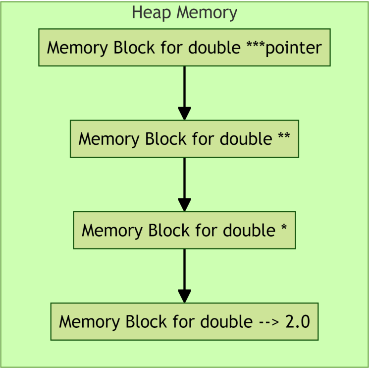
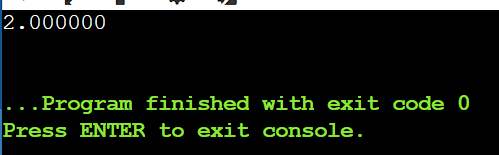

# Тема: Лабораторная работа #1. Указатели

## Задача 1: упражнения с malloc и сложными однострочными выражениями в C с присваиваниями внутри.

### Постановка задачи:

Внутри функции int main(void) { /*...*/ } определите указатель:

double ***pointer = NULL;

Инициализируйте этот указатель адресом другого указателя типа double **, который указывает, в свою очередь, на
переменную double. 
Используйте pointer для записи и чтения в эту переменную значения 2.

При этом выполните следующее: - Используйте функции типа *alloc(...) для выделения оперативной памяти под
динамические объекты; - Запишите и выведите число 2 на экран, используя указатель double ***pointer = NULL;;
- Используйте функцию free(...) для освобождения оперативной памяти, выделенной под динамические объекты.
- Не используйте никаких идентификаторов переменных, кроме pointer.

### Математическая модель:
### Диаграмма памяти:

Задача демонстрирует работу с многоуровневыми указателями и динамическим выделением памяти. В куче создаётся цепочка из четырёх объектов:

1. `pointer` (тип `double ***`) хранит адрес блока `*pointer`, в котором лежит указатель типа `double **`.
2. `*pointer` (тип `double **`) хранит адрес блока `**pointer`, в котором лежит указатель типа `double *`. 
3. `**pointer` (тип `double *`) хранит адрес блока `***pointer`, в котором лежит искомое значение типа `double` (число 2.0). 

При разыменовании `***pointer` мы проходим по цепочке: `pointer ->  *pointer -> **pointer -> ***pointer = 2.0`.

#### Ход работы:

1. Выделить память под `double **` и записать её адрес в `pointer`.
2. Выделить память под `double *` и записать её адрес в `*pointer`.
3. Выделить память под `double` и записать её адрес в `**pointer`.
4. Записать значение `***pointer = 2.0`, прочитать и вывести его.
5. Освободить память в обратном порядке выделения: `**pointer`, `*pointer`, `pointer`.
### Список идентификаторов:

| Имя переменной | Тип данных | Описание |
|----------------|------------|----------|
| `pointer` | `double ***` | Указатель верхнего уровня; через него (`*pointer`, `**pointer`, `***pointer`) выполняется доступ ко всем динамическим объектам, включая итоговое значение типа `double` |

### Код программы:

```c
#include <stdio.h>
#include <stdlib.h>

int main(void)
{
    double ***pointer = NULL;

    pointer = malloc(sizeof(double **));
    *pointer = malloc(sizeof(double *));
    **pointer = malloc(sizeof(double));

    ***pointer = 2.0;
    printf("%f\n", ***pointer);

    free(**pointer);
    free(*pointer);
    free(pointer);

    return 0;
}
```

### Результаты выполненной работы:


