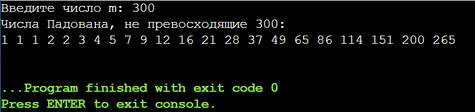
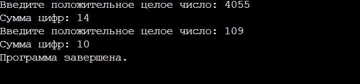
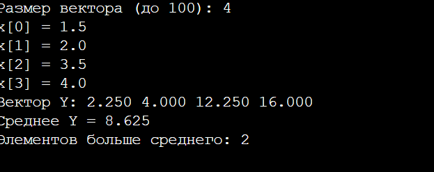
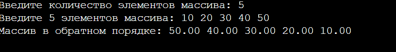
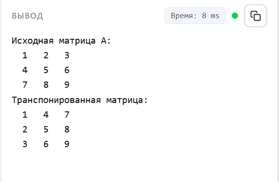
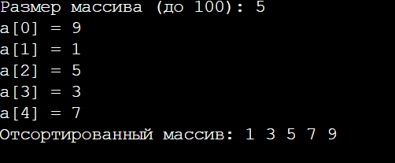
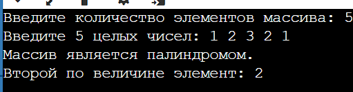

# Практическая работа №1
## Тема: Числовые последовательности, сумма цифр положительного числа и массивы.
## Задача 1: Числовые последовательности
### Постановка задачи:
 Организовать и распечатать последовательность чисел Падована, не превосходящих число 𝑚, введенное с клавиатуры. Числа Падована представлены следующим рядом:
1, 1, 1, 2, 2, 3, 4, 5, 7, 9, 12, 16, 21, 28, 37, 49, 65, 86, 114, 151, 200, 265, …
Использовать конструкцию for и простые варианты условной конструкции if else. Для этих чисел заданы формулы: 
𝑃 (0) = 𝑃 (1) = 𝑃 (2) = 1, 𝑃 (𝑛) = 𝑃 (𝑛 − 2) + 𝑃 (𝑛 − 3)
### Математическая модель: 
Последовательность Падована определяется рекуррентным соотношением $P(n) = P(n-2) + P(n-3)$ с начальными условиями $P(0) = P(1) = P(2) = 1$. Для вычисления очередного члена достаточно хранить три последних числа последовательности: $a = P(n-3)$, $b = P(n-2)$, $c = P(n-1)$; тогда $P(n) = a + b$, после чего окно сдвигается: $a \leftarrow b$, $b \leftarrow c$, $c \leftarrow P(n)$. Цикл прерывается, когда очередное число превосходит $m$.

### Список идентификаторов:

| Имя переменной | Тип данных | Смысловое обозначение |
| :--- | :--- | :--- |
| `m` | `long long` | Максимальное число, введённое с клавиатуры (верхняя граница) |
| `a` | `long long` | Значение \(P(n-3)\) (третий элемент назад) |
| `b` | `long long` | Значение \(P(n-2)\) (второй элемент назад) |
| `c` | `long long` | Значение \(P(n-1)\) (предыдущий элемент) |
| `n` | `int` | Счётчик цикла (текущий индекс числа Падована) |
| `p` | `long long` | Текущее вычисленное значение \(P(n)\) |


### Код программы: 

```c
#include <stdio.h>

int main(void) 
{
    long long m;
    printf("Введите число m: ");
    scanf("%lld", &m);

    if (m < 1) {
        printf("Чисел Падована, не превосходящих %lld, нет.\n", m);
        return 0;
    }

    long long a = 1; /* P(n-3) */
    long long b = 1; /* P(n-2) */
    long long c = 1; /* P(n-1) */

    printf("Числа Падована, не превосходящие %lld:\n", m);

    for (int n = 0; ; n++) {
        long long p;
        if (n < 3) {
            p = 1; /* P(0) = P(1) = P(2) = 1 */
        } else {
            p = a + b; /* P(n) = P(n-2) + P(n-3) */
            a = b;
            b = c;
            c = p;
        }
        if (p > m) {
            break;
        }
        printf("%lld ", p);
    }
    printf("\n");

    return 0;
}
```
### Результаты работы программы: 

## Задача 2: Сумма цифр положительного числа
### Постановка задачи:
 С клавиатуры вводится произвольное целое положительное число, считается сумма его цифр. Если сумма цифр числа
больше 10, то вводится следующее число, если сумма меньше либо равна 10 — программа завершается.

Математические операции:

• Для разбиения числа на цифры используйте целочисленное деление и операцию получения остатка от деления в языке C.
– Целочисленное деление (/): при делении целых чисел результат является целым числом без остатка.
– Остаток от деления (%): возвращает остаток от деления одного целого числа на другое.
• При работе с произвольным числом необходимо реализовать цикл для последовательного извлечения всех цифр
числа.
Алгоритм программы:
1. Ввод числа:
• Ввести положительное целое число num с клавиатуры.
• Проверить, что num положительное.
2. Вычисление суммы цифр:
• Инициализировать переменную sum нулём.
• Пока num больше нуля:
– Добавить к sum остаток от деления num на 10 (последняя цифра числа).
– Разделить num на 10 без остатка (убрать последнюю цифру).
3. Проверка суммы цифр:
• Если сумма цифр sum больше 10, повторить ввод следующего числа (перейти к шагу 1).
• Если сумма цифр sum меньше либо равна 10, завершить программу.

### Математическая модель: 

Последняя цифра числа: `d = num % 10`; число без последней цифры: `num = num / 10` (целочисленное деление). Повторяя эти два действия, пока `num > 0`, суммируем все цифры: `sum = d₀ + d₁ + … + dₖ`.

Внешний цикл `do…while` повторяет ввод нового числа, пока `sum > 10`. Внутренний `do…while` повторяет ввод, пока число не положительное. Чтобы не потерять введённое число, цифры извлекаются из копии `tmp`.

### Список идентификаторов:

| Имя переменной | Тип данных | Описание |
|---|---|---|
| `num` | `long long` | Введённое положительное число |
| `tmp` | `long long` | Копия числа, из которой извлекаются цифры |
| `sum` | `int` | Сумма цифр числа |

### Код программы: 

```c
#include <stdio.h>

int main(void) {
    long long num, tmp;
    int sum;

    do {
        do {
            printf("Введите положительное целое число: ");
            scanf("%lld", &num);
            if (num <= 0) {
                printf("Ошибка: число должно быть положительным.\n");
            }
        } while (num <= 0);

        tmp = num;
        sum = 0;
        while (tmp > 0) {
            sum += tmp % 10;   /* последняя цифра */
            tmp /= 10;         /* убираем последнюю цифру */
        }
        printf("Сумма цифр: %d\n", sum);
    } while (sum > 10);

    printf("Программа завершена.\n");
    return 0;
}
```

### Результаты работы программы:


## Задача 3. Массивы. Задача 1
### Постановка задачи:
Для заданного числового вектора 𝑋, введённого с клавиатуры, выполнить следующие действия:
1. Вычислить вектор 𝑌, где каждый элемент 𝑦𝑖 = 𝑥2
𝑖
.
2. Найти среднее арифметическое элементов вектора 𝑌.
3. Определить количество элементов вектора 𝑌, превышающих найденное среднее значение.
### Математическая модель: 

$y_i = x_i^2,\quad \bar{y} = \dfrac{1}{n}\sum_{i=0}^{n-1} y_i$

Количество элементов: $k = |\{ i : y_i > \bar{y} \}|$.

### Список идентификаторов:
| Имя переменной | Тип данных | Описание |
|---|---|---|
| n | int | Размер вектора |
| count | int | Количество элементов Y больше среднего |
| x | double[100] | Исходный вектор X |
| y | double[100] | Вектор Y (квадраты элементов X) |
| sum | double | Сумма элементов Y |
| avg | double | Среднее арифметическое Y |
| i | int | Счётчик цикла |


### Код программы:

```c
#include <stdio.h>

int main(void) 
{
    int n, count = 0;
    double x[100], y[100], sum = 0, avg;

    printf("Размер вектора (до 100): ");
    scanf("%d", &n);

    for (int i = 0; i < n; i++) {
        printf("x[%d] = ", i);
        scanf("%lf", &x[i]);
        y[i] = x[i] * x[i];           /* y_i = x_i^2 */
        sum += y[i];
    }
    avg = sum / n;

    for (int i = 0; i < n; i++)
        if (y[i] > avg)
            count++;

    printf("Вектор Y: ");
    for (int i = 0; i < n; i++)
        printf("%.3f ", y[i]);
    printf("\n");
    printf("Среднее Y = %.3f\n", avg);
    printf("Элементов больше среднего: %d\n", count);
    return 0;
}
```
### Результат работы программы:


   
## Массивы. Задача 2
### Постановка задачи: 
Для некоторого числового массива 𝑋, введённого с клавиатуры поэлементно, изменить порядок элементов на обратный и распечатать результат на экране.

### Математическая модель:
Перестановка элементов выполняется «на месте»: для каждого $i < n/2$ элементы $x_i$ и $x_{n-1-i}$ меняются местами.

### Список идентификаторов

| Имя переменной | Тип данных | Смысловое обозначение |
| --- | --- | --- |
| `n` | `int` | Количество элементов массива |
| `x` | `double[100]` | Исходный массив |
| `tmp` | `double` | Временная переменная для обмена |
| `i` | `int` | Счётчик цикла |
### Код программы:

```c
#include <stdio.h>

int main(void) {
    int n;
    printf("Введите количество элементов массива: ");
    scanf("%d", &n);

    double x[100];
    printf("Введите %d элементов массива: ", n);
    for (int i = 0; i < n; i++) {
        scanf("%lf", &x[i]);
    }

    /* Изменение порядка элементов на обратный (на месте) */
    for (int i = 0; i < n / 2; i++) {
        double tmp = x[i];
        x[i] = x[n - 1 - i];
        x[n - 1 - i] = tmp;
    }

    printf("Массив в обратном порядке: ");
    for (int i = 0; i < n; i++) {
        printf("%.2f ", x[i]);
    }
    printf("\n");

    return 0;
}
```

### Результаты работы программы:



## Массивы. Задача 3
### Постановка задачи: 
 Транспонировать матрицу:
>
> $$A = \begin{bmatrix} 1 & 2 & 3 \\ 4 & 5 & 6 \\ 7 & 8 & 9 \end{bmatrix}$$
### Математическая модель:
Транспонированная матрица: Tⱼᵢ = Aᵢⱼ, т.е. строки исходной матрицы становятся столбцами.
### Список идентификаторов

| Имя переменной | Тип данных | Описание |
|---|---|---|
| `A` | `int[3][3]` | Исходная матрица |
| `T` | `int[3][3]` | Транспонированная матрица |
| `i` | `int` | Индекс строки |
| `j` | `int` | Индекс столбца |
### Код программы:

```c
#include <stdio.h>
int main(void)
{
    int A[3][3] = {
        {1, 2, 3},
        {4, 5, 6},
        {7, 8, 9}
    };
    int T[3][3];
    int i, j;

    for (i = 0; i < 3; i++) {
        for (j = 0; j < 3; j++) {
            T[j][i] = A[i][j];
        }
    }

    printf("Исходная матрица A:\n");
    for (i = 0; i < 3; i++) {
        for (j = 0; j < 3; j++) {
            printf("%3d ", A[i][j]);
        }
        printf("\n");
    }
    printf("Транспонированная матрица:\n");
    for (i = 0; i < 3; i++) {
        for (j = 0; j < 3; j++) {
            printf("%3d ", T[i][j]);
        }
        printf("\n");
    }
    return 0;
}
```
### Результаты работы программы:


## Массивы. Задача 4
### Постановка задачи: 
Реализовать самостоятельно алгоритм сортировки вставками (без создания своих функций, внутри функции main).

### Математическая модель:
Для $i = 1, \dots, n-1$: элемент $key = a_i$ вставляется в уже отсортированную часть $a_0 \dots a_{i-1}$: все элементы, большие $key$, сдвигаются на одну позицию вправо, затем $key$ записывается на освободившееся место.

### Список идентификаторов:

| Имя переменной | Тип данных | Описание |
|---|---|---|
| n | int | Размер массива |
| a | int[100] | Сортируемый массив |
| key | int | Вставляемый элемент |
| i | int | Индекс текущего элемента |
| j | int | Индекс для сдвига элементов |

### Код программы:

```c
#include <stdio.h>

int main(void) 
{
    int n, a[100];

    printf("Размер массива (до 100): ");
    scanf("%d", &n);
    for (int i = 0; i < n; i++) {
        printf("a[%d] = ", i);
        scanf("%d", &a[i]);
    }

    for (int i = 1; i < n; i++) {
        int key = a[i];
        int j = i - 1;
        while (j >= 0 && a[j] > key) {
            a[j + 1] = a[j];          /* сдвиг вправо */
            j--;
        }
        a[j + 1] = key;               /* вставка */
    }

    printf("Отсортированный массив: ");
    for (int i = 0; i < n; i++)
        printf("%d ", a[i]);
    printf("\n");
    return 0;
}
```

### Результат работы программы: 



## Массивы. Задача 5
### Постановка задачи: 
Дан массив целых чисел 𝐴, введённый с клавиатуры. Требуется:
1. Определить, является ли массив палиндромом.

• Массив называется палиндромом, если он читается одинаково слева направо и справа налево.

2. Найти второй по величине элемент в массиве.

• Если все элементы одинаковы, вывести соответствующее сообщение.
### Математическая модель:

Палиндром: массив является палиндромом, если $a_i = a_{n-1-i}$ для всех $i = 0, \dots, \lfloor n/2 \rfloor - 1$.

Второй по величине элемент: наибольшее значение среди элементов, строго меньших максимального: $\max\{a_i : a_i < \max A\}$. За один проход по массиву поддерживаются два значения: `max1` (максимум) и `max2` (наибольший элемент, меньший `max1`). Если такого элемента не нашлось, все элементы одинаковы.

### Список идентификаторов:

| Имя переменной | Тип данных | Смысловое обозначение |
| --- | --- | --- |
| `n` | `int` | Количество элементов массива |
| `a` | `int[100]` | Массив целых чисел |
| `is_palindrome` | `int` | Признак палиндрома (1 — да, 0 — нет) |
| `max1` | `int` | Максимальный элемент массива |
| `max2` | `int` | Второй по величине элемент |
| `has_second` | `int` | Признак существования второго по величине элемента |
| `i` | `int` | Счётчик цикла |


### Код программы:

```c
#include <stdio.h>

int main(void) {
    int n;
    printf("Введите количество элементов массива: ");
    scanf("%d", &n);

    int a[100];
    printf("Введите %d целых чисел: ", n);
    for (int i = 0; i < n; i++) {
        scanf("%d", &a[i]);
    }

    /* Проверка на палиндром */
    int is_palindrome = 1;
    for (int i = 0; i < n / 2; i++) {
        if (a[i] != a[n - 1 - i]) {
            is_palindrome = 0;
            break;
        }
    }
    if (is_palindrome) {
        printf("Массив является палиндромом.\n");
    } else {
        printf("Массив не является палиндромом.\n");
    }

    /* Поиск второго по величине элемента */
    int max1 = a[0], max2;
    int has_second = 0;
    for (int i = 1; i < n; i++) {
        if (a[i] > max1) {
            max2 = max1;
            max1 = a[i];
            has_second = 1;
        } else if (a[i] < max1 && (!has_second || a[i] > max2)) {
            max2 = a[i];
            has_second = 1;
        }
    }
    if (has_second) {
        printf("Второй по величине элемент: %d\n", max2);
    } else {
        printf("Все элементы массива одинаковы, второго по величине элемента нет.\n");
    }

    return 0;
}
```
### Результат работы программы:

